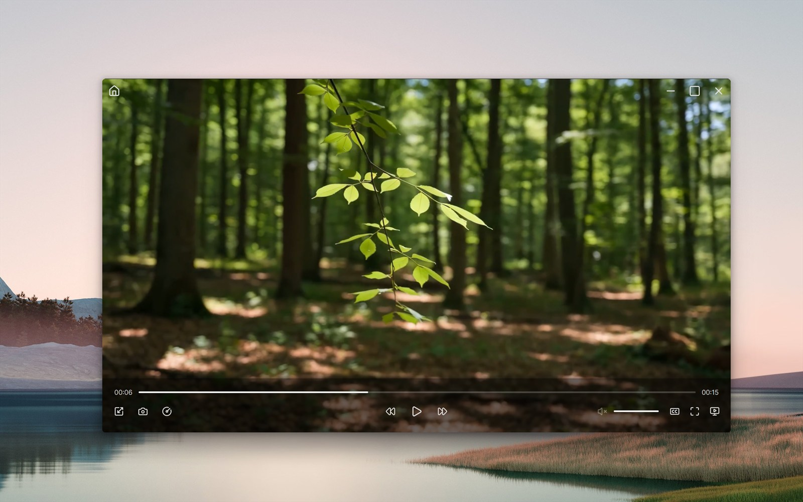
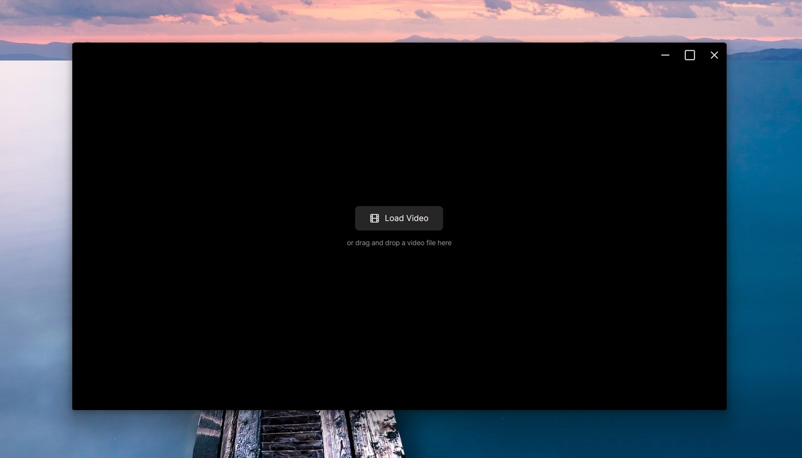
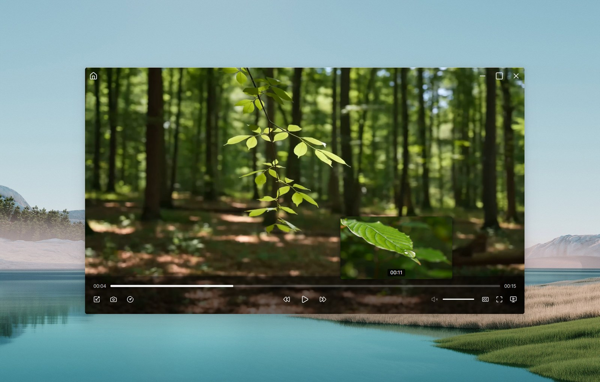
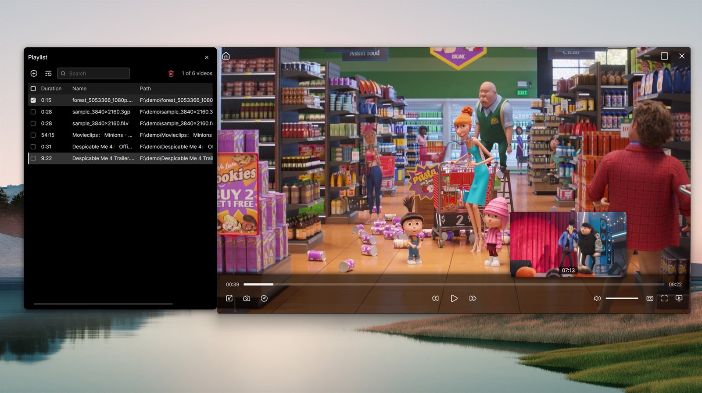

<p align="center">
  
</p>

# Chroa Video Player

### A minimal, frameless video player for Windows (for now 😊 Linux, MacOS are planned), powered by **mpv** and built with **Avalonia UI**.

Chroa is a small, quiet player that stays out of the way: frameless and ad-free, so you can focus on the
video. Powered by [libmpv](https://mpv.io/), it plays almost every video format and never asks you to
download extra decoders — .mpeg, .rm, .hevc, .f4v, .asf, .3gp, .mkv and many more.


[](https://github.com/kevincantstop/chroa-video-player/releases/latest)

## ⬇️ Download

**[→ Get the latest release](https://github.com/kevincantstop/chroa-video-player/releases/latest)** — pick
`chroa-video-player-v<version>-x64.zip` (also available for `x86` and `arm64`), unzip it anywhere and
run `ChroaVideoPlayer.exe`.

> Just unzip and run — everything the player needs is already inside, there is nothing to install.
> The build is not code-signed, so Windows SmartScreen may warn on first run — click
> **More info → Run anyway**.

## Screenshots

<p align="center">
  
</p>

| **True frameless video player when playing** | **Before anything is loaded** |
| :---: | :---: |
|  |  |
| **Frames Preview when hovering on progress bar** | **Very powerful playlist manager** |
|  |  |

## Formats

Chroa plays **more than 150 file extensions**. These are the 50 people ask about most — plus subtitles and
streams:

**Video** — .mkv .mp4 .mov .avi .webm .wmv .asf .flv .f4v .mpg .mpeg .m2v .ts .m2ts .mts .vob .rm .rmvb .3gp
.3g2 .ogv .dv .mxf .nut

**Rare ones** — .y4m .ivf .wtv .thp .roq .pva .nsv .mtv .smk .r3d .dpx .exr .gif .avif .swf

**Audio** — .mp3 .m4a .aac .flac .wav .ogg .opus .wma .ra .ac3 .dts

**Subtitles** — .srt .ass .ssa .sub .sup

**Streams** — HLS (.m3u8), DASH (.mpd), RTSP, RTMP

**Codecs** — H.264, H.265 / HEVC, AV1, VP9, MPEG-2, VC-1, ProRes, DNxHR, RealVideo, WMV, Theora, VVC

Nothing needs installing for any of it: no codec packs, no decoder downloads.

## Requirements

- Windows 10 / 11 (developed and tested on Windows 11)

To run a released build nothing else is needed. To build from source you need the
[.NET 10 SDK](https://dotnet.microsoft.com/download/dotnet/10.0).

## Getting started

This repository ships **no third-party binaries** — the folder the player loads its native library from
is excluded from version control. A fresh clone therefore builds but cannot play anything until an
[mpv](https://mpv.io/) build is placed at `ChroaVideoPlayer\native\libmpv-2.dll`.

```powershell
git clone https://github.com/kevincantstop/chroa-video-player.git
cd chroa-video-player
dotnet run --project ChroaVideoPlayer
```

## Credits

Powered by [mpv](https://mpv.io/) and [FFmpeg](https://ffmpeg.org/), with an interface built on
[Avalonia](https://avaloniaui.net/). Released builds bundle the following components, each under its own
license:

- **libmpv / mpv** — GPLv2+, Windows build by
  [shinchiro](https://github.com/shinchiro/mpv-winbuild-cmake), version
  `v0.41.0-1115-gb2c255c13`; upstream source
  [mpv-player/mpv](https://github.com/mpv-player/mpv).
- **ANGLE** (`av_libglesv2.dll`) — BSD-3-Clause, Copyright 2018 The ANGLE
  Project Authors.
- **SkiaSharp**, **HarfBuzzSharp** — MIT, Copyright (c) 2015-2016 Xamarin, Inc.
  and Copyright (c) 2017-2018 Microsoft Corporation.
- **Inter** font, embedded in `Avalonia.Fonts.Inter.dll` — SIL Open Font
  License 1.1, Copyright (c) 2016 The Inter Project Authors
  (<https://github.com/rsms/inter>).
- **Avalonia UI**, **CommunityToolkit.Mvvm**, **HanumanInstitute.LibMpv** and the
  remaining managed dependencies — MIT.

## License

[GPL-2.0-or-later](LICENSE) © 2026 kevincantstop

Chroa Video Player
Copyright (C) 2026 kevincantstop

This program is free software: you can redistribute it and/or modify it under
the terms of the GNU General Public License as published by the Free Software
Foundation, either version 2 of the License, or (at your option) any later
version.

This program is distributed in the hope that it will be useful, but WITHOUT ANY
WARRANTY; without even the implied warranty of MERCHANTABILITY or FITNESS FOR A
PARTICULAR PURPOSE. See the GNU General Public License for more details.

You should have received a copy of the GNU General Public License along with
this program. If not, see <https://www.gnu.org/licenses/>.

See [LICENSE](LICENSE) for the full text.
